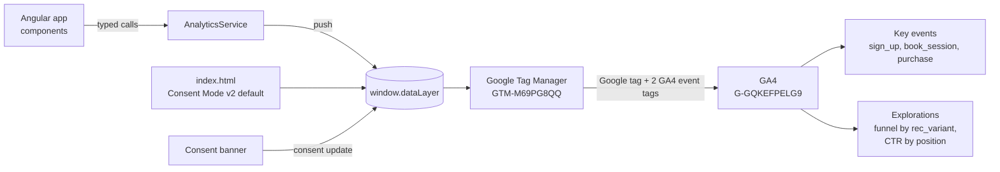

# Coach Connect+ analytics

**The measurement layer for Coach Connect+, my tennis coaching platform: GA4 and Google Tag Manager on a real Angular product, from measurement plan to automated tracking QA.**

[](https://github.com/GerasimoskiDesign/coach-connect-analytics/actions/workflows/ci.yml)

**Live demo:** https://gerasimoskidesign.github.io/coach-connect-analytics/
Log in with any email and any password, or sign up. All data is synthetic.

## What this shows

- **Measurement plan**: business goals mapped to KPIs, events and reports. [docs/measurement_plan.md](docs/measurement_plan.md)
- **Tracking plan**: every event, its trigger, parameters, key event flag and the business question it answers. [docs/tracking_plan.csv](docs/tracking_plan.csv)
- **dataLayer**: one typed Angular service is the only code that writes to `window.dataLayer`. [analytics.service.ts](src/app/core/analytics/analytics.service.ts)
- **Google Tag Manager**: an importable container generated from the tracking plan, with a click-by-click fallback. [gtm/container.json](gtm/container.json), [docs/GTM_MANUAL_SETUP.md](docs/GTM_MANUAL_SETUP.md)
- **Consent Mode v2**: all four signals denied by default, a consent banner, and the stored choice re-applied before GTM loads. [src/index.html](src/index.html)
- **Key events**: `sign_up`, `book_session` and `purchase`, with GA4 setup steps. [docs/GA4_SETUP.md](docs/GA4_SETUP.md)
- **A/B recommendation measurement**: two ranking algorithms, a persistent 50/50 split, and a user property so GA4 can compare click-through and bookings per variant.
- **Automated tracking QA**: Playwright reads `window.dataLayer` on the production build and validates every event against the tracking plan on every push.

## How the data flows



## Events

Generated from [docs/tracking_plan.csv](docs/tracking_plan.csv), which is the source of truth for the GTM container and the tests.

| Event | Type | Fires when | Key parameters | Key event |
|---|---|---|---|---|
| `page_view_spa` | custom | Angular Router NavigationEnd, including the first load. Sent to GA4 as `page_view`. | `page_path`, `page_title`, `page_location` | no |
| `set_user_properties` | custom | App start (once per browser session), and when sign-up, login or the player level change the user properties | `rec_variant`; when signed in `user.user_id`, `user.user_role`, `user.signup_date`, `user.player_level` | no |
| `sign_up` | recommended | Registration form succeeded (`email`), or the demo created the account at the first login with an unknown email (`auto_login`) | `method`, `user_role` | **yes** |
| `login` | recommended | Login with an existing account | `method`, `user_role` | no |
| `search` | recommended | Coach search submitted (Enter or Search button) | `search_term`, `filter_level`, `filter_city` | no |
| `view_item_list` | recommended | Recommendations rendered on the dashboard: coaches (`rec_coaches`) or players (`rec_players`) | `item_list_id`, `item_list_name`, `items[].item_id`, `items[].item_name`, `items[].item_category`, `items[].item_variant`, `items[].index`, `items[].price`, `rec_algorithm` | no |
| `select_item` | recommended | Click on a recommended coach or player | `item_list_id`, `item_list_name`, `items[].item_id`, `items[].item_name`, `items[].index`, `rec_algorithm`, `rec_score` | no |
| `view_item` | recommended | Coach profile loaded | `currency`, `value`, `items[].item_id`, `items[].item_name`, `items[].item_category`, `items[].item_variant`, `items[].price` | no |
| `book_session` | custom | Session request sent, by a player (to a coach or a player) or by a coach (to a player) | `session_request_id`, `interaction_type`, `requester_role`, `receiver_id`, `receiver_role`, `coach_id`, `session_type`, `player_level`, `duration_minutes`, `value`, `currency`; `rec_list_id`, `rec_algorithm`, `rec_index` (empty unless it came from a recommendation) | **yes** |
| `session_request_responded` | custom | The receiver accepted, declined or rescheduled a request | `session_request_id`, `response`, `responder_role`, `interaction_type` | no |
| `purchase` | recommended | Demo payment confirmed on the checkout page | `transaction_id`, `value`, `currency`, `items[].item_id`, `items[].item_name`, `items[].price`, `items[].quantity`, `player_level`; items carry `item_list_id`, `index`, `rec_algorithm` when the booking came from a recommendation | **yes** |

User ID and user properties: `user_id` (the account UUID), `user_role`, `signup_date`, `player_level` (players: 1-4 `amateur`, 5-7 `intermediate`, 8-10 `professional`) and `rec_variant`. Only allow-listed keys can reach the dataLayer; no emails, names or phone numbers (item names are `Coach 1a2b3c4d`, not the person's name).

A coach is the "item": `item_category` is the coach's main specialty, `item_variant` the player level they coach, `price` the hourly rate in EUR, and `index` the rank shown on screen (1 is the top card).

Example push, as it lands in the dataLayer:

```js
dataLayer.push({ ecommerce: null });   // clear the previous ecommerce object first
dataLayer.push({
  event: 'select_item',
  ecommerce: {
    item_list_id: 'rec_coaches',
    item_list_name: 'Recommended coaches',
    items: [{ item_id: 'c0ac0000-0000-4000-8000-000000000023', item_name: 'Coach c0ac0000', index: 1 }],
  },
  rec_algorithm: 'content_based',
  rec_score: 0.961,
  // plus the other event-scoped keys set to undefined, so GTM drops stale values
});
```

## Consent approach

- `index.html` sets `gtag('consent', 'default', ...)` with `ad_storage`, `ad_user_data`, `ad_personalization` and `analytics_storage` all `denied` and `wait_for_update: 500`, **before** the GTM snippet.
- The banner offers Accept and Decline with equal weight. A choice sends `gtag('consent', 'update', ...)` for all four signals and is stored in `localStorage`.
- On the next visit, an inline script re-applies the stored choice before GTM loads, so tags never fire on a stale default. Storage access is wrapped in `try/catch`.
- Google tags have built-in consent checks, so Consent Mode runs in advanced mode: with consent denied, GA4 receives cookieless pings and can model the gap.
- A Playwright test proves nothing is `granted` in the dataLayer until the visitor clicks Accept.

## A/B recommendation measurement

On a visitor's first visit the app assigns `rec_variant` = `content_based` or `popularity` (50/50, stored in `localStorage`) and ranks the recommended coaches with that algorithm:

- **content_based** scores each coach against the player's profile: level fit, goals vs specialties, surface, city, coaching style.
- **popularity** ranks by a Bayesian-smoothed rating blended with review volume and ignores the player.

`rec_variant` is sent as a user-scoped custom dimension; every `select_item` also carries `rec_algorithm` and `rec_score`. That answers: which algorithm gets more clicks, at which positions, and which one leads to more bookings and revenue per user. Add `?rec_variant=popularity` to the URL to force a variant for QA.

## GTM container

`gtm/container.json` is generated by [`gtm/build-container.mjs`](gtm/build-container.mjs) from the tracking plan and imports through **Admin > Import Container**.

| Kind | What |
|---|---|
| Tags | **Google tag** (`G-GQKEFPELG9`, automatic page_view off, `user_id`, user properties `rec_variant`, `user_role`, `signup_date`, `player_level`) on Initialization - All Pages. **GA4 event tag** for custom and recommended events. **GA4 ecommerce event tag** with "Send ecommerce data" from the dataLayer. Each event tag sends exactly the parameters the tracking plan lists for its events. |
| Triggers | One Custom Event trigger per tracked event (`CE - book_session`, ...), exact match on the event name. |
| Variables | Constant `GA4 Measurement ID`, 30 Data Layer Variables (v2), a lookup table that renames `page_view_spa` to `page_view`, Google tag configuration and event settings, built-in `Event`. |

Two design choices worth calling out, both explained in [DECISIONS.md](DECISIONS.md):

1. **Ecommerce data is read by its own tag.** GTM keeps the last `ecommerce` object in its data model, so a single tag with "Send ecommerce data" would attach stale items to `book_session` or `search`.
2. **Event-scoped keys are reset on every push.** For the same reason, a `value` pushed with `book_session` would otherwise ride along on every later event. The service sets unused keys to `undefined`, and a test replays the dataLayer the way GTM merges it to prove nothing leaks.

## Automated tracking QA

Playwright runs against the exact GitHub Pages build, served under `/coach-connect-analytics/`. Google endpoints are stubbed, so tests never send data to the real property.

| Check | Test |
|---|---|
| Nothing but the consent default is pushed as `granted` before Accept | [consent.spec.ts](tests/e2e/consent.spec.ts) |
| Stored choice is re-applied before GTM; Decline is remembered | [consent.spec.ts](tests/e2e/consent.spec.ts) |
| Full journey (sign up, search, recommendation click, profile, book, pay, answer a request, log out, log in) fires every tracking plan event with every required parameter, and no key outside the plan | [journey.spec.ts](tests/e2e/journey.spec.ts) |
| No email, name or phone number in any parameter; item names are IDs | [journey.spec.ts](tests/e2e/journey.spec.ts) |
| `user_id` and the user properties are set at sign-up, carried on every event and cleared at logout | [journey.spec.ts](tests/e2e/journey.spec.ts) |
| Coach-to-player and player-to-player bookings, bookings without a recommendation, auto-login sign-up, decline and reschedule | [roles.spec.ts](tests/e2e/roles.spec.ts) |
| Values agree across the funnel (same coach id, value and currency from `select_item` to `purchase`) | [journey.spec.ts](tests/e2e/journey.spec.ts) |
| Every ecommerce event is immediately preceded by `{ ecommerce: null }` | [journey.spec.ts](tests/e2e/journey.spec.ts) |
| No stale parameter reaches a later event in GTM's data model | [journey.spec.ts](tests/e2e/journey.spec.ts) |
| `page_view_spa` fires once per route change, never twice, including redirects | [page-views.spec.ts](tests/e2e/page-views.spec.ts) |
| Container is valid, matches the tracking plan (one trigger per event, exact parameters per tag), the app's event-scoped keys match the plan, and IDs agree across files | [container.test.mjs](tests/unit/container.test.mjs) |

## Traffic simulation

The GA4 property is filled with synthetic traffic by [`simulation/simulate.mjs`](simulation/README.md): a visible Chromium drives the live demo one user at a time, each in a fresh browser with consent granted. The mix is 70% returning seeded players, 20% new players and 10% new coaches, with full bookings, abandons at every step, repeat visits and a balanced A/B split. Hard caps, a fixed target URL and stop-on-failure rules keep it safe to leave running.

## Screenshots

<!-- TODO(Mario): add the screenshots below to docs/img/ and replace each placeholder with an image link. -->

| | |
|---|---|
| **GTM Preview** <br/> TODO(Mario): `docs/img/gtm-preview.png` | **GA4 DebugView** <br/> TODO(Mario): `docs/img/ga4-debugview.png` |
| **GA4 Realtime** <br/> TODO(Mario): `docs/img/ga4-realtime.png` | **Key events** <br/> TODO(Mario): `docs/img/ga4-key-events.png` |
| **Funnel exploration by rec_variant** <br/> TODO(Mario): `docs/img/ga4-funnel.png` | |

## Run it locally

Requires Node 22.

```bash
npm ci
npm start                     # dev server on http://localhost:4200, mock backend included
```

Build and test exactly what CI runs:

```bash
npm run build:pages           # production build with base href /coach-connect-analytics/ and 404.html
npx playwright install chromium
npm test                      # unit checks + Playwright tracking QA
npm run gtm:build             # regenerate gtm/container.json after editing the tracking plan
```

Open the browser console and type `dataLayer` to watch events arrive as you click through.

## Repository map

```
docs/                     measurement plan, tracking plan, GA4 and GTM setup, manual steps
gtm/                      container.json and the generator that builds it
src/app/core/analytics/   AnalyticsService, consent, A/B assignment, typed event models
src/app/core/mock/        in-browser mock backend and the two recommendation algorithms
src/index.html            Consent Mode v2 default and the GTM snippet
tests/e2e/                Playwright tracking QA
tests/unit/               GTM container and ID checks
simulation/               traffic simulation that sends the demo data to GA4
.github/workflows/ci.yml  build, test and deploy to GitHub Pages
```

## About the data

Everything you see is synthetic: 40 generated coaches, 24 generated players, invented clubs and a demo checkout that takes no card details. The Angular frontend is the real Coach Connect+ client; its .NET backend and Python recommendation service are excluded on purpose and replaced by an in-browser mock, so the demo runs as a static site with no server and no personal data.

Decisions made while building this, and why: [DECISIONS.md](DECISIONS.md). Build log: [PROGRESS.md](PROGRESS.md).
